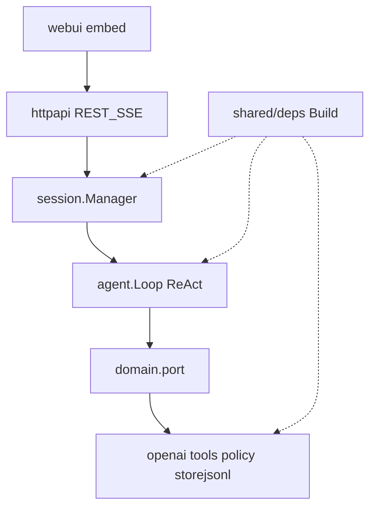

# dsh-go 设计与实现分析及改进建议

> 分析对象：`dsh-go` 当前代码与配置（服务端 Coding Agent）。
> 本文只做评审与改进建议，不构成代码改动。
> 与「生产级全栈四层闭环」的对照与扩展路线，见同目录
> [fullstack-arch-analysis.md](./fullstack-arch-analysis.md)。

## 一、产品定位澄清

当前实现是**可部署的服务端 Coding Agent**：

- 单二进制 `dshd` + YAML 配置
- 模型、会话、工具、审批经 HTTP API 暴露，事件经 SSE 推送
- 内嵌单页 Web UI，在服务器工作区上读代码、改代码、构建、测试、用 git 管理变更

它**不是**「一键生成可直接部署前后端应用」的应用工厂：没有脚手架模板、没有产物预览环境、没有 Deploy/CI 管线。若目标是全栈闭环（规划 → 编码 → 自验证 → 部署），现有内核覆盖的是其中的**编码与执行层**；扩展路线见 [fullstack-arch-analysis.md](./fullstack-arch-analysis.md)。

本文聚焦：**现有 Harness 级内核的设计质量、实现优劣，以及不改产品定位前提下的加固与增强**。

## 二、架构总览

分层对齐仓库 go-ddd 规范与 DeepSeek Harness（dsh）的可替换层，用注册表 + 组合根替代 Cordis：

| 层 | 路径 | 职责 |
|---|---|---|
| 入口 | `cmd/dshd` | 加载配置、装配、启 HTTP、优雅关闭 |
| 组合根 | `internal/shared/deps` | 唯一装配点：模型仓储 → LLM → 存储 → 工具 → 钩子 → Loop → Manager → task |
| 接口 | `interfaces/httpapi`、`interfaces/webui` | REST + SSE；`go:embed` 单页控制台 |
| 应用 | `application/agent`、`application/session` | ReAct 循环、子代理；会话生命周期、审批、SSE 订阅 |
| 领域 | `domain/entity`、`port`、`plugin`、`derr` | 中立协议、端口、插件注册表、哨兵错误 |
| 基础设施 | `infrastructure/adapter/*`、`config` | OpenAI 兼容 LLM、JSONL 会话、六件工具、策略钩子、状态栏 |

端到端回合：

1. `POST /v1/sessions/{id}/messages` → `Manager.RunTurn`（异步 202）
2. `Loop.RunTurn`：追加 user → `buildContext` → `llm.Chat` → 有 tool_calls 则 PreToolUse → Execute → 结果回注；无则结束
3. 事件 append 到 JSONL，并 fan-out 到 SSE 订阅者
4. 高风险操作经 `policy` 阻塞审批，UI/`POST .../approvals/{aid}` 裁决

## 三、设计优点

### 3.1 六边形边界清晰

能力契约集中在 `domain/port`（`LLMPort`、`Tool`、`SessionStorePort`、`Hook`、`StatusBarPort`、`LLMInfoRepo`、`LLMResolver`、`SessionRuntime`）。application 只依赖端口；实现在 adapter；`deps.Build` 是唯一组合根。符合「抄设计、不抄 Cordis/Node」的纪律，后续换存储、换 LLM、加 MCP 时可做到上层零感知。

### 3.2 ReAct 工程化完整

相对「裸调模型 + 几个工具」的原型，内核具备生产 Harness 常见护栏：

- **唯一正常终止**：模型不再调用工具；轮数 / token 预算 / 活性指纹 / 熔断均为保护性终止
- **错误即输入**：幻觉工具名、参数畸形、超时、审批拒绝一律以工具结果回注，不杀会话
- **分级恢复**：429/5xx/超时可重试（指数退避、尊重 Retry-After）；400/401 快速失败；连续失败熔断
- **轨迹完整性**：上下文投影时补齐缺配对的 tool result，避免协议损坏导致整轮崩溃

### 3.3 状态模型成熟

append-only JSONL 为唯一事实源；Messages 是投影。支持 resume、fork（血缘 header + 前缀复制）、replay、search。`task` 子代理独立上下文：中间轨迹 spill 落盘可审计，结论回主会话，深度计数 + 工具视图过滤禁止嵌套委派。这比「把长日志塞进同一上下文」更符合隔离优于压缩的实践。

### 3.4 安全与成本意识（轻量 Agent 中偏强）

- 三档审批（suggest / auto-edit / full-auto）+ bash 命令语义风险启发式
- 模型 API 视图不暴露密钥本体，只返回 `api_key_source`
- 系统提示词 + 工具定义为稳定静态前缀；时间 / cwd / git 走状态栏追加末尾，利于 KV Cache

### 3.5 可扩展地基已就位

`Hook`（Pre/PostToolUse）、`LLMInfoRepo` 契约测试套件、工具注册顺序稳定、按会话选模型的 `LLMResolver`，为后续自验证工具、MCP 适配器、规划编排提供挂载点，而无需先推翻内核。

### 3.6 运维与测试形态克制

依赖极少（标准库 HTTP + yaml.v3）；单二进制易部署。领域与工具层测试覆盖 ReAct、子代理、JSONL、策略、仓储契约等（`go test ./dsh-go/...`），质量重心放在「循环正确性」而非 UI 皮相。

## 四、设计与实现缺点

### 4.1 相对「可部署全栈软件」目标的产品缺口

无独立规划层、无系统化测试/Fix Loop 工具、无部署与预览。六件通用工具 + 提示词工作流可以「现写现验」，但无法保证可重复的交付闭环。细节与整合顺序见 [fullstack-arch-analysis.md](./fullstack-arch-analysis.md)。

### 4.2 执行隔离不足

沙盒为进程级（独立进程组 + 超时 + 审批），非 OS 内核级（Seatbelt/Landlock）或容器级。工作区即会话 `cwd` 字符串，无多租户/项目实体。共享密钥鉴权下，不适合直接暴露为公网多用户服务。

### 4.3 策略启发式有上限

命令风险解析依赖切段、展开 `$()`/反引号与效果规则，不是完整 shell AST；fork 炸弹等模式不在 v1 覆盖范围。攻击面存在，依赖人工审批与部署侧隔离兜底。

### 4.4 接口层薄弱

- `interfaces/httpapi`、`webui` 无自动化测试；路由/SSE/鉴权回归靠手工
- `server.go` 集中全部 REST；Web UI 为单文件 HTML/JS，可维护性上限低
- SSE `Subscribe` 只推新事件，客户端先 `GET /events` 再 `stream` 存在竞态窗口（中间事件可能漏接）

### 4.5 实时性与鉴权体验

- LLM Chat 非流式；SSE 推结构化会话事件，不是 token 打字机
- 鉴权为共享 Bearer；EventSource 用 `?token=`，token 易进日志/Referer
- 空 `auth_token` 即不鉴权；`/healthz` 与非 `/v1/`（含整个 UI）放行，部署文档若未强调易踩坑

### 4.6 记忆与上下文策略偏约定

无 RAG / 结构化记忆库；长期记忆依赖提示词引导读写 `AGENTS.md`。长会话靠 spill 与 `task` 卸荷，缺摘要压缩或窗口滑动策略，token 预算触顶后体验硬切。

### 4.7 工具面与语法反馈有限

核心工具：bash / read / write / edit / glob / grep + task。无浏览器、数据库、MCP。写后语法检查覆盖 gofmt / py_compile / bash -n / node --check 等，对 TypeScript/前端工程链支持弱。

## 五、改进建议

### P0 — 加固现有内核（不改产品定位）

| 项 | 建议 | 理由 | 状态 |
|---|---|---|---|
| HTTP 集成测 | 为 `httpapi` 补 `httptest`：鉴权、创建会话、202 回合、审批、SSE 握手 | 接口层是当前最大测试缺口 | ✅ 已落地：`httpapi/server_test.go` 覆盖鉴权、空令牌放行、201→202 回合、审批拒绝流、ticket 一次性兑换、SSE 补发与 `Last-Event-ID` |
| SSE 游标 | 订阅支持 `from_seq` / `Last-Event-ID`，与 `GET /events` 语义对齐 | 消除历史与实时之间的丢事件窗口 | ✅ 已落地：stream handler 先订阅再按 seq 补发去重；每条事件写 `id:`/`event:`/`data:` 三行，支持 `?from_seq=N` 与 `Last-Event-ID` |
| 鉴权收紧 | 生产默认强制 `auth_token`；EventSource 改短期 ticket 或 Cookie，避免长期 token 进 URL | 降低凭证泄露面 | ✅ 已落地：`POST /v1/tickets` 签发 60s 一次性 ticket，stream 支持 `?ticket=` 兑换；`config.CheckDeployment` 拒绝「非回环监听 + 空令牌」启动 |
| 部署前置约束 | 文档与启动检查强调：多租户必须容器隔离；可选 cwd 白名单（禁止逃逸到工作区外） | 与 README 已知边界一致，产品化时不可省略 | ✅ 已落地：`security.allowed_cwd_roots` 白名单经 `Manager.SetCwdGuard` 注入，创建会话时校验且先于 `MkdirAll`；启动检查见上 |

### P1 — 提升编码交付质量

| 项 | 建议 | 理由 | 状态 |
|---|---|---|---|
| 自验证工具 | 新增 `run_tests`（或约定测试命令的封装），增强 PostToolUse lint | Fix Loop 是 ReAct + 错误回注的涌现行为，缺的是专用入口 | ✅ 已落地（此前轮次）：`run_tests` 工具接入现有审批/Hook 管道 |
| 流式/进度 | LLM token 流式，或至少更细的 notice（迭代进度、工具耗时） | 改善长回合体感，不改变控制结构 | ✅ 已落地：`progress` marker（迭代轮次/本轮与累计 tokens、工具耗时），不进 Messages 投影、零 token 成本；Web UI 轻量渲染 |
| 上下文压缩 | 摘要消息或滑动窗口，与 spill、`task` 互补 | 降低硬触预算的概率 | ✅ 已落地：投影层确定性压缩（`session/compress.go`）——累计 token 达 `context_compress_at_percent` 后较早长输出替换为「摘录 + spill 路径」，日志本体完整、按 seq 缓存幂等、首次激活注入说明 notice |
| Web UI 拆分 | 静态资源分文件或轻量前端构建，保留 embed 交付 | 避免单文件膨胀，便于加审批/模型管理 UI | ✅ 已落地：`webui/static/` 拆分 index.html + app.css + app.js，`embed.FS` + `http.FileServerFS` 服务（单二进制交付不变）；附三资源可达性与引用漂移冒烟测试 |

### P2 — 向「全栈可部署」愿景扩展

原则与落位点（不重复展开实现细节）：

1. **自验证层** → 见 P1；成本最低、收益直接
2. **MCP 客户端适配器** → 实现 `port.Tool`，经现有 Hook/审批管道，命名空间防冲突
3. **规划编排用例** → application 层按角色建会话 / fork 血缘 / 分角色选模型，不引入外部多智能体框架
4. **部署工具** → 模板化高风险工具 + 强制审批（不可被 full-auto 豁免）+ 容器隔离评估

完整对照与推荐顺序见 [fullstack-arch-analysis.md](./fullstack-arch-analysis.md) 第六节。

### 整合时应守住的纪律

1. 抄设计不抄依赖：编排自研，MCP 只引协议客户端
2. 端口在 domain，实现在 infrastructure；组合根注入
3. 错误即输入：协议错误、测试失败、部署失败一律回注工具结果
4. 安全边界不旁路：新工具（含 MCP）必须经 Hook 与审批
5. 新资源仓储先立契约测试（照 `port/contracttest`）

## 六、结论

**dsh-go 作为 Harness 级 Coding Agent 内核，设计成熟、实现克制且可扩展**：端口边界、ReAct 护栏、append-only 会话与子代理隔离构成了扎实地基；在同类轻量服务端 Agent 中，审批与恢复路径属于优势项。

相对「为用户构建可直接部署的前后端软件」这一产品愿景，仍缺规划编排、系统化自验证与部署/预览三层能力——但这些应落在**现有内核之上的适配器与编排用例**，而不是推倒重来。短期应优先 P0 加固接口与安全边界，再用 P1 把验证闭环接上，最后按 P2 与四层对照文档收口全栈闭环。
